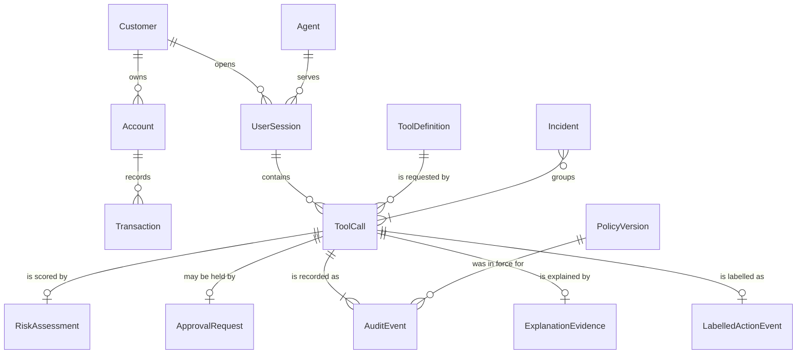

# Synthetic data schema and rules

Everything AgentSentinel stores or tests with is invented. This folder defines the shape of that data once, so every service, generator and test agrees on it (story US-15).

| File | What it is |
|---|---|
| `models.py` | The schema as Pydantic models. Services and generators import these. |
| `examples.json` | One valid example of every entity. The tests check each one against its model. |
| `labelling-rules.md` | How every action event gets its expected outcome and failure mode. |
| `README.md` | This document: the rules, the entities and every field. |

Schema version: **1.0.0** (`SCHEMA_VERSION` in `models.py`). A change to any entity goes through a pull request, bumps the version and updates this document. A test fails if a model field is missing from this page.

## Rules for synthetic data

These rules meet NFR-08 (privacy: synthetic data only). The models enforce the ones marked *enforced*.

1. **Everything is invented.** No real customer, account, transaction, credential, bank endpoint or bank policy text is used or copied.
2. **One seed.** Generators use the fixed random seed `20261109`, so the same command always produces the same data. Each generated dataset carries a manifest with the seed, generator version, row counts and SHA-256 checksum.
3. **Email addresses** use only `example.com`, `example.org` or `example.net`. These domains are reserved for documentation and can never reach a real person. *Enforced.*
4. **Phone numbers** use only `+1-555-0100` to `+1-555-0199`, the range reserved for fictional use. *Enforced.*
5. **Identifiers** use the project's own prefixes (`CUS-`, `ACC-`, `TXN-` and so on). No real bank formats: no IBANs, routing numbers, card numbers or SWIFT codes. *Enforced.*
6. **Never generated:** government ID numbers, dates of birth, card numbers, passwords or security answers. The models reject any field they do not define. *Enforced.*
7. **Addresses** appear only as tool arguments and follow one fictional pattern: `<number> Example Street, Sampletown, ZZ 00000`.
8. **Money** is in USD with two decimals. Transaction amounts are positive and balances are never negative. *Enforced.*
9. **Dates and times** are UTC with an explicit offset, inside the fixed window 1 January 2025 to 31 October 2026, so results do not depend on the day the generator runs. *Time zone enforced.*
10. **Attacker accounts** in prompt-injection scenarios use the reserved range `ACC-99000000` to `ACC-99999999`, so they are easy to recognize in logs and tests.
11. **Untrusted content** (emails and documents carrying hidden instructions) is written by the team as fixtures. Nothing is scraped from the internet.
12. **No secrets.** Data, fixtures and prompts never contain API keys, tokens or passwords. Prompts built from this data contain synthetic values only.

## How the entities relate



Every protected action gets a `correlation_id`. The risk assessment, approval request, audit events, explanation and incident for that action all carry the same value, which is how an incident is reconstructed (FR-13, FR-14).

## Entities

### Customer

A customer of the fictional demo bank.

| Field | Type | Meaning | Example |
|---|---|---|---|
| `customer_id` | `CUS-` and 6 digits | Customer identifier | `CUS-000123` |
| `full_name` | text, up to 80 characters | Invented name from the seeded generator | `Avery Stone` |
| `email` | email at example.com, .org or .net | Always at a reserved example domain | `avery.stone123@example.com` |
| `phone` | phone +1-555-01xx | Always in the fictional 555-01xx range | `+1-555-0142` |
| `created_at` | date and time with time zone (UTC) | When the customer record was created (UTC) | `2025-06-02T09:30:00Z` |

### Account

A bank account owned by one customer.

| Field | Type | Meaning | Example |
|---|---|---|---|
| `account_id` | `ACC-` and 8 digits | Account identifier | `ACC-00000123` |
| `customer_id` | `CUS-` and 6 digits | Owner of the account | `CUS-000123` |
| `account_type` | one of `checking`, `savings` | checking or savings | `checking` |
| `currency` | always USD | Demo bank holds USD only | `USD` |
| `balance` | amount with 2 decimals | Current balance | `2480.55` |
| `status` | one of `open`, `frozen`, `closed` | open, frozen or closed | `open` |
| `opened_at` | date and time with time zone (UTC) | When the account was opened (UTC) | `2025-06-02T09:35:00Z` |

### Transaction

A posted movement on an account.

| Field | Type | Meaning | Example |
|---|---|---|---|
| `transaction_id` | `TXN-` and 10 digits | Transaction identifier | `TXN-0000004567` |
| `account_id` | `ACC-` and 8 digits | Account the transaction belongs to | `ACC-00000123` |
| `transaction_type` | one of `purchase`, `deposit`, `transfer`, `fee`, `refund` | purchase, deposit, transfer, fee or refund | `purchase` |
| `amount` | amount with 2 decimals | Positive amount; the type gives the direction | `750.00` |
| `currency` | always USD | USD | `USD` |
| `description` | text, up to 140 characters | Short invented description | `Online order 88213 (invented merchant)` |
| `related_transaction_id` | `TXN-` and 10 digits, or empty | For a refund, the purchase being refunded | empty |
| `created_at` | date and time with time zone (UTC) | When the transaction was posted (UTC) | `2026-03-10T18:44:09Z` |

### Agent

An AI agent registered with AgentSentinel, with the tools it may propose and its risk thresholds.

| Field | Type | Meaning | Example |
|---|---|---|---|
| `agent_id` | `AGT-` and 3 digits | Agent identifier in the registry | `AGT-001` |
| `name` | text, up to 40 characters | Display name, for example Vera | `Vera` |
| `role` | text, up to 40 characters | Role that policy uses, for example customer_service | `customer_service` |
| `allowed_tools` | list of tool name in snake_case | Tools this agent may ever propose | `["get_customer", "get_transactions", "update_address", "issue_refun...` |
| `status` | one of `active`, `disabled`, `quarantined` | active, disabled or quarantined | `active` |
| `review_threshold` | number from 0 to 1 | Risk score at or above this goes to human review | `0.6` |
| `block_threshold` | number from 0 to 1 | Risk score at or above this is blocked | `0.85` |
| `created_at` | date and time with time zone (UTC) | When the agent was registered (UTC) | `2026-01-05T08:00:00Z` |

### ToolDefinition

A bank tool the agent can ask for, and what makes it sensitive.

| Field | Type | Meaning | Example |
|---|---|---|---|
| `tool_name` | tool name in snake_case | Name the agent uses to call the tool | `issue_refund` |
| `category` | one of `read`, `write`, `financial`, `export`, `admin` | read, write, financial, export or admin | `financial` |
| `description` | text, up to 200 characters | What the tool does | `Refund a posted transaction to the customer's own account` |
| `high_impact` | true or false | True when a wrong call could move money or expose data | `true` |
| `sensitive_parameters` | list of text | Arguments whose origin must be tracked | `["account_id", "amount"]` |
| `allowed_task_types` | list of one of `account_inquiry`, `refund_request`, `profile_update`, `dispute`, `admin_maintenance` | Tasks for which the tool may be used | `["refund_request", "dispute"]` |

### UserSession

One conversation between a signed-in customer and an agent. It fixes the customer scope and the task.

| Field | Type | Meaning | Example |
|---|---|---|---|
| `session_id` | `SES-` and 8 digits | Session identifier | `SES-00000042` |
| `customer_id` | `CUS-` and 6 digits | The signed-in customer the agent is serving | `CUS-000123` |
| `agent_id` | `AGT-` and 3 digits | Agent handling the session | `AGT-001` |
| `channel` | text, up to 20 characters | Where the session runs, for example web_chat | `web_chat` |
| `task_type` | one of `account_inquiry`, `refund_request`, `profile_update`, `dispute`, `admin_maintenance` | What the customer asked for | `refund_request` |
| `started_at` | date and time with time zone (UTC) | Session start (UTC) | `2026-03-14T15:00:00Z` |
| `expires_at` | date and time with time zone (UTC) | Session end (UTC) | `2026-03-14T15:30:00Z` |

### ToolCall

One protected action proposed by the agent. This is the request the gateway evaluates.

| Field | Type | Meaning | Example |
|---|---|---|---|
| `correlation_id` | UUID version 4 | UUID version 4 that ties every record of this action together | `3f2b8c1e-5a7d-4e9b-9c1a-2d4f6a8b0c1e` |
| `session_id` | `SES-` and 8 digits | Session the action belongs to | `SES-00000042` |
| `agent_id` | `AGT-` and 3 digits | Agent proposing the action | `AGT-001` |
| `customer_scope` | `CUS-` and 6 digits | Customer the session is bound to | `CUS-000123` |
| `task_type` | one of `account_inquiry`, `refund_request`, `profile_update`, `dispute`, `admin_maintenance` | Task the agent is working on | `refund_request` |
| `tool_name` | tool name in snake_case | Tool the agent wants to call | `issue_refund` |
| `arguments` | structured values (JSON object) | Structured tool arguments | `{"account_id": "ACC-00000123", "amount": "750.00", "original_transa...` |
| `provenance_labels` | map of argument name to one of `trusted_user_input`, `untrusted_content`, `system` | Origin of each argument: trusted_user_input, untrusted_content or system | `{"account_id": "trusted_user_input", "amount": "trusted_user_input"...` |
| `requested_at` | date and time with time zone (UTC) | When the agent proposed the action (UTC) | `2026-03-14T15:02:11Z` |

### PolicyVersion

A version of the OPA policy bundle.

| Field | Type | Meaning | Example |
|---|---|---|---|
| `policy_version` | version such as 1.0.0 | Version of the OPA policy bundle | `1.0.0` |
| `bundle_checksum` | SHA-256 as 64 hex characters | SHA-256 of the bundle | `c3e5fe22ac145ae4f12d741bd04a0e3818c93df2c7d51e1874599ad5e29e3c02` |
| `description` | text, up to 200 characters | What changed in this version | `First bundle: tool permissions, bulk export deny, refund limits` |
| `is_active` | true or false | True for the bundle the gateway uses now | `true` |
| `activated_at` | date and time with time zone (UTC), or empty | When it became active (UTC) | `2026-01-05T08:00:00Z` |

### RiskAssessment

The risk model's score for one action.

| Field | Type | Meaning | Example |
|---|---|---|---|
| `correlation_id` | UUID version 4 | Action that was scored | `3f2b8c1e-5a7d-4e9b-9c1a-2d4f6a8b0c1e` |
| `model_version` | version such as 1.0.0 | Version of the risk model | `0.1.0` |
| `feature_schema_version` | version such as 1.0.0 | Version of the feature layout the model expects | `1.0.0` |
| `risk_score` | number from 0 to 1 | 0 is safe, 1 is most risky | `0.31` |
| `risk_band` | one of `low`, `medium`, `high` | low, medium or high | `low` |
| `top_features` | list of text | Features that contributed most, where the model supports it | `["threshold_proximity", "tool_category"]` |
| `assessed_at` | date and time with time zone (UTC) | When the score was produced (UTC) | `2026-03-14T15:02:11Z` |

### ApprovalRequest

A held action waiting for, or decided by, a human approver.

| Field | Type | Meaning | Example |
|---|---|---|---|
| `approval_id` | `APR-` and 6 digits | Approval request identifier | `APR-000007` |
| `correlation_id` | UUID version 4 | Held action | `3f2b8c1e-5a7d-4e9b-9c1a-2d4f6a8b0c1e` |
| `requested_by` | `AGT-` and 3 digits | Agent whose action is held | `AGT-001` |
| `reason` | text, up to 300 characters | Why the action needs a person | `Refund of 750.00 USD is above the automatic limit of 200.00 USD` |
| `status` | one of `pending`, `approved`, `rejected`, `expired` | pending, approved, rejected or expired | `approved` |
| `approver_id` | `USR-` and 4 digits, or empty | Staff member who decided | `USR-0003` |
| `created_at` | date and time with time zone (UTC) | When the request was raised (UTC) | `2026-03-14T15:02:12Z` |
| `expires_at` | date and time with time zone (UTC) | When an undecided request lapses (UTC) | `2026-03-14T16:02:12Z` |
| `decided_at` | date and time with time zone (UTC), or empty | When it was decided (UTC) | `2026-03-14T15:09:40Z` |

### AuditEvent

One hash-linked record in the audit trail.

| Field | Type | Meaning | Example |
|---|---|---|---|
| `event_id` | `EVT-` and 6 digits | Position of the event in the chain | `EVT-000001` |
| `correlation_id` | UUID version 4 | Action the event describes | `3f2b8c1e-5a7d-4e9b-9c1a-2d4f6a8b0c1e` |
| `event_type` | one of `action_received`, `policy_evaluated`, `risk_assessed`, `decision_made`, `approval_requested`, `approval_decided`, `action_executed`, `action_stopped`, `agent_quarantined`, `explanation_generated` | What happened | `decision_made` |
| `actor` | text, up to 40 characters | Service, agent or staff member that acted | `sentinel-gateway` |
| `decision` | one of `ALLOW`, `HUMAN_REVIEW`, `BLOCK`, `QUARANTINE`, or empty | Outcome, on decision events | `HUMAN_REVIEW` |
| `policy_version` | version such as 1.0.0, or empty | Policy bundle in force | `1.0.0` |
| `model_version` | version such as 1.0.0, or empty | Risk model in force | `0.1.0` |
| `payload` | structured values (JSON object) | Decision inputs and results for this step | `{"matched_rules": ["refund.above_auto_limit"], "risk_score": 0.31, ...` |
| `created_at` | date and time with time zone (UTC) | When the event was written (UTC) | `2026-03-14T15:02:11Z` |
| `previous_event_hash` | SHA-256 as 64 hex characters | Hash of the event before this one; 64 zeros for the first | `0000000000000000000000000000000000000000000000000000000000000000` |
| `event_hash` | SHA-256 as 64 hex characters | SHA-256 over this event's content and previous_event_hash | `eacd8116e61fd65fd94710b468a422db3750f63e1a4c5df3c37beceaa5b9a985` |

### Incident

A group of related actions that an analyst reviews together.

| Field | Type | Meaning | Example |
|---|---|---|---|
| `incident_id` | `INC-` and 6 digits | Incident identifier | `INC-000002` |
| `agent_id` | `AGT-` and 3 digits | Agent involved | `AGT-001` |
| `correlation_ids` | list of UUID version 4 | Actions that make up the incident | `["7a1c9e42-0b3d-4f6a-8e2c-5d7f9b1a3c5e"]` |
| `severity` | one of `low`, `medium`, `high`, `critical` | low, medium, high or critical | `high` |
| `status` | one of `open`, `closed` | open or closed | `open` |
| `summary` | text, up to 300 characters | One-line description for the dashboard | `Refund destination came from an untrusted email; action blocked` |
| `opened_at` | date and time with time zone (UTC) | When the incident was opened (UTC) | `2026-03-15T11:20:05Z` |
| `closed_at` | date and time with time zone (UTC), or empty | When it was closed (UTC) | empty |

### ExplanationEvidence

The plain-English explanation of a decision and the policy sections it cites.

| Field | Type | Meaning | Example |
|---|---|---|---|
| `correlation_id` | UUID version 4 | Decision being explained | `3f2b8c1e-5a7d-4e9b-9c1a-2d4f6a8b0c1e` |
| `plain_english_reason` | text, up to 800 characters | Explanation shown to analysts and approvers | `The refund was held because it is above the amount Vera may refund without a manager's approval.` |
| `evidence_ids` | list of text | Policy section IDs the explanation cites | `["RAP-3.2"]` |
| `provider_model_version` | text, up to 80 characters | LLM provider and model used, or mock | `mock-1.0` |
| `generated_at` | date and time with time zone (UTC) | When the explanation was generated (UTC) | `2026-03-14T15:02:14Z` |

### LabelledActionEvent

One labelled row of the risk model's dataset. See [labelling-rules.md](labelling-rules.md).

| Field | Type | Meaning | Example |
|---|---|---|---|
| `event_id` | `EVT-` and 6 digits | Row identifier | `EVT-000001` |
| `sequence_id` | `SEQ-` and 6 digits | Groups the actions of one session into a sequence | `SEQ-000001` |
| `position` | whole number | Order of the action inside its sequence, starting at 1 | `2` |
| `tool_call` | a ToolCall record | The proposed action | the ToolCall example above |
| `expected_outcome` | one of `ALLOW`, `HUMAN_REVIEW`, `BLOCK`, `QUARANTINE` | Label: what AgentSentinel should decide | `HUMAN_REVIEW` |
| `failure_mode` | one of `none`, `prompt_injection`, `misunderstood_instruction`, `wrong_tool_or_invalid_details`, `outside_authority`, `unintended_sequence` | Label: which failure mode this is, or none | `none` |
| `use_case` | use case ID, or empty | Use case the scenario comes from | `UC-03` |
| `rule` | text, up to 10 characters | Labelling rule that set the outcome, for example R3 | `R6` |
| `split` | one of `train`, `validation`, `test`, or empty | train, validation or test, set once and frozen | `train` |

## Audit hash rule

Each audit event stores the hash of the event before it, so a changed or deleted event breaks the chain (FR-13, NFR-06).

1. Take every field of the event except `event_hash`.
2. Write them as JSON with keys sorted and no extra spaces.
3. `event_hash` is the SHA-256 of that text. The first event uses 64 zeros as `previous_event_hash`.

The example in `examples.json` follows this rule and a test recomputes it.

## Using the schema

```python
from data.synthetic.models import Customer

customer = Customer.model_validate({"customer_id": "CUS-000123", "full_name": "Avery Stone",
                                    "email": "avery.stone123@example.com", "phone": "+1-555-0142",
                                    "created_at": "2025-06-02T09:30:00Z"})
```

A record that breaks a rule, such as an email at a real domain, raises a validation error. Run the schema tests with `python -m pytest tests/test_synthetic_schema.py` (on Windows, `py -m pytest ...`).

