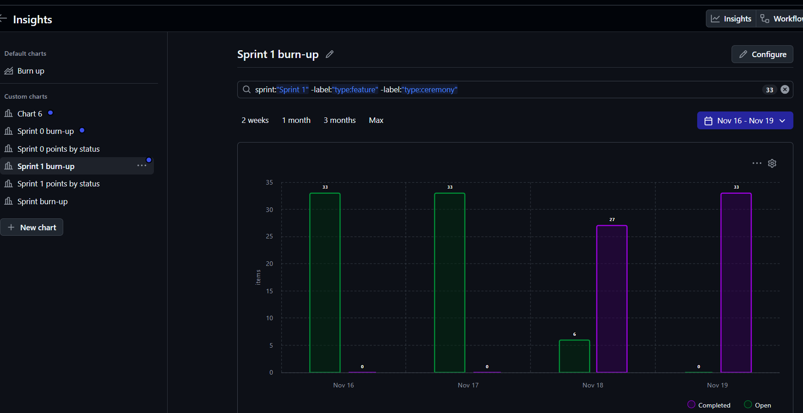
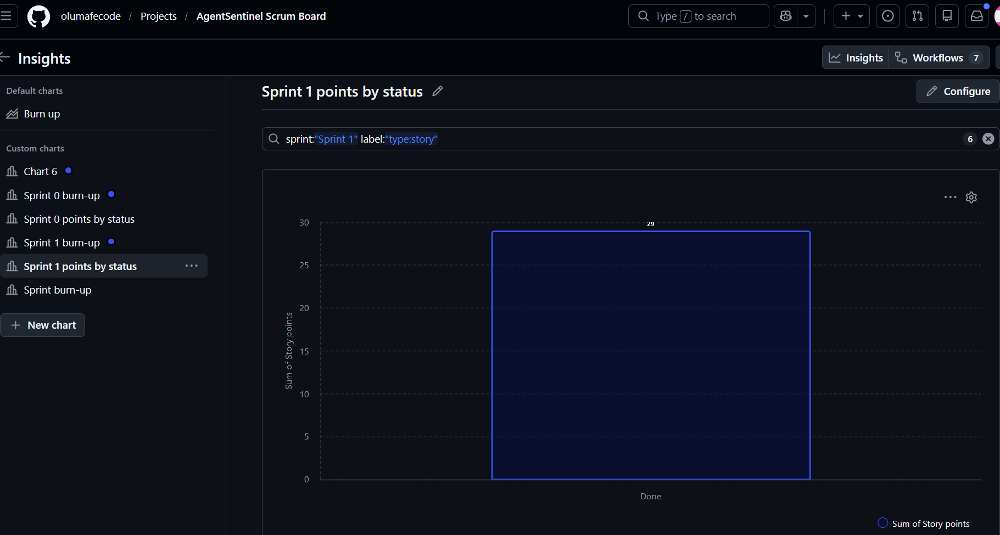
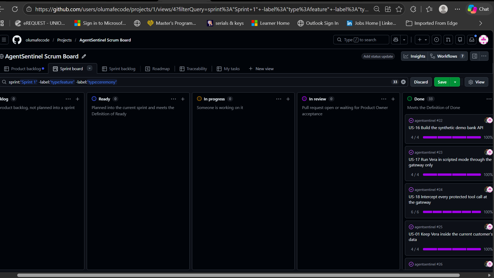
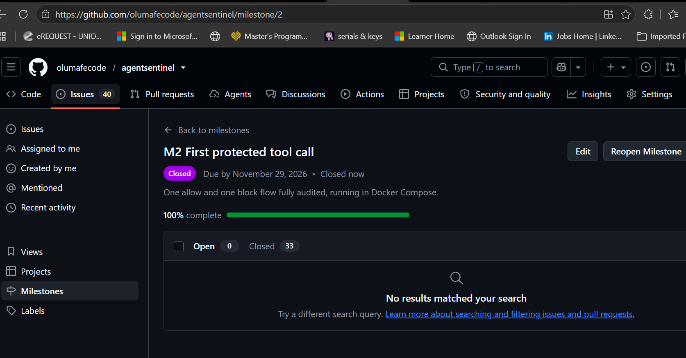
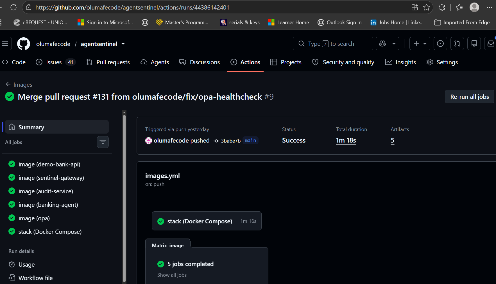

# Sprint 1 review

**Date:** 19 November 2026  
**Attendees:** Olusanya Mafe / Siyabonga Jali  
**Demo recording (for the Product Owner):** https://drive.google.com/file/d/1WZzN4OKv1049JFT8m8W5b1gbM0JVXtco/view?usp=sharing  

## Sprint goal

One ALLOW and one BLOCK flow run end to end through the gateway and are fully audited (milestone M2).

Met? Yes. `docker compose up` starts PostgreSQL, OPA, the demo bank and the gateway, and waits until each one reports healthy. Customer A's lookup of her own transactions is allowed and returns her data (AT-01). A lookup of Customer B's records from her session is blocked, and the bank receives no request at all (AT-02). Every decision is written to the hash-linked audit trail. `verify-chain` reports the chain intact and `completeness` reports every action fully audited. The Images workflow runs the same flow in Docker Compose on every pull request.

All six stories were merged by 18 November, 11 days before the planned review date.

## What the demo shows

1. `py tools/dev/make_env.py` and `docker compose up --build --wait`: every service reports healthy.
2. `docker compose run --rm vera`: UC-01 allowed; UC-02 and UC-05 blocked; UC-04 blocked, then allowed for Avery's own data; UC-03, UC-06 and UC-07 listed as pending on US-03, US-04 and US-05.
3. `docker compose run --rm audit verify-chain` and `docker compose run --rm audit completeness`.
4. The tamper test: a recorded BLOCK is changed to ALLOW directly in the database, and `verify-chain` names the changed event.
5. A merged pull request with green `ci` and Images checks, including **stack (Docker Compose)**.
6. The board with every Sprint 1 story Done.

## Stories

| Story | Points | Accepted by Product Owner? | Evidence (pull request, CI run, time in the recording) |
|---|---|---|---|
| US-18 Intercept every protected tool call at the gateway | 8 |  Accepted | PR #121 (contracts), PR #123 (gateway); token replay tests in `services/sentinel-gateway/tests/test_execution_tokens.py`; [00:26] |
| US-16 Build the synthetic demo bank API | 3 | Accepted | PR #122; [00:28] |
| US-01 Keep Vera inside the current customer's data | 5 | Accepted | PR #125; `tests/acceptance/test_at01_safe_lookup.py` and `test_at02_cross_customer_lookup.py`; [00:42] |
| US-19 Write a hash-linked audit event for every decision | 5 | Accepted | PR #126; tamper test in `services/audit-service/tests/test_store.py`; [01:28] |
| US-20 Run the whole stack with one Docker Compose command | 3 | Accepted | PR #126 and PR #131; green Images run on main [https://github.com/olumafecode/agentsentinel/actions/runs/44386142401]; [00:17] |
| US-17 Run Vera in scripted mode through the gateway only | 5 | Accepted | PR #126; `apps/banking-agent/tests`; [00:06] |

**Velocity:** _29_ points accepted out of 29 planned.

## Milestone M2: first protected tool call

- [x] AT-01 and AT-02 pass in CI and in the Compose stack
- [x] `verify-chain` and `completeness` pass after Vera's scenarios run in the Compose stack
- [x] Milestone M2 closed on GitHub

Signed off by: Siyabonga Jali  
Date:  19 November 2026

## Changes from the plan

- The two work tracks did not hold. US-17, US-19 and US-20 were planned for Siyabonga and built by Olusanya; Siyabonga reviewed and merged them in PR #126.
- Added during the sprint: before an action that names an account, transaction or dispute, the gateway asks the bank who owns it (ADR-013). A refund into another customer's account is therefore already blocked in Sprint 1, ahead of the data-origin checks in US-02b.
- The first Images run on `main` failed because OPA's health check needed `wget`, which the official OPA image does not have. PR #131 fixed it the same day with an OPA image of our own.
- Dependabot now keeps the Python base images on 3.12 and ignores setuptools bumps.

## Board evidence

- Burn-up chart screenshot:

- Points-by-status chart screenshot:

- Sprint 1 board at sprint end:

- Milestone M2 closed:

- Images workflow with the Compose stack job green:

## Backlog changes agreed

- Stories returned to the backlog or moved to Sprint 2: None
- New stories or bugs added: None
- To confirm before US-02a: the tool-to-task mapping in `tools.json`, and whether Vera's allowed tools should include `get_accounts`.
- Scenarios UC-03, UC-06 and UC-07 become active when US-03, US-04 and US-05 are done.
- Moving the base images to Python 3.15 is left for a later decision; CI tests on 3.12.
- Priority changes: None
