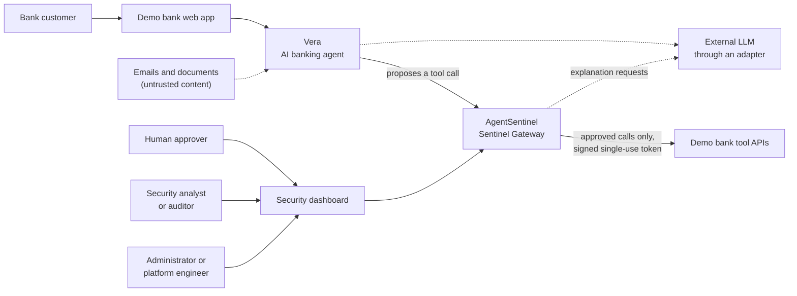
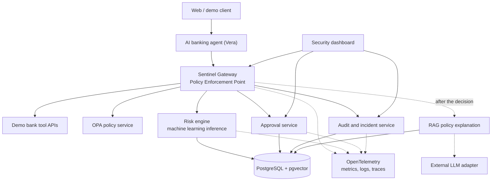
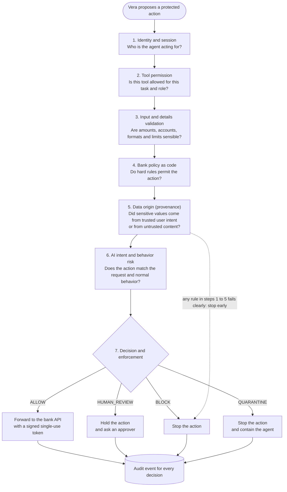
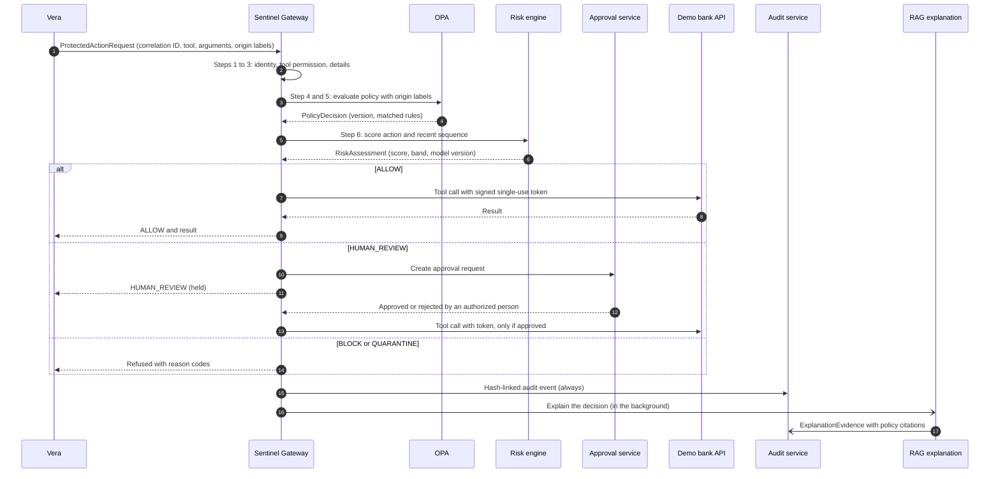
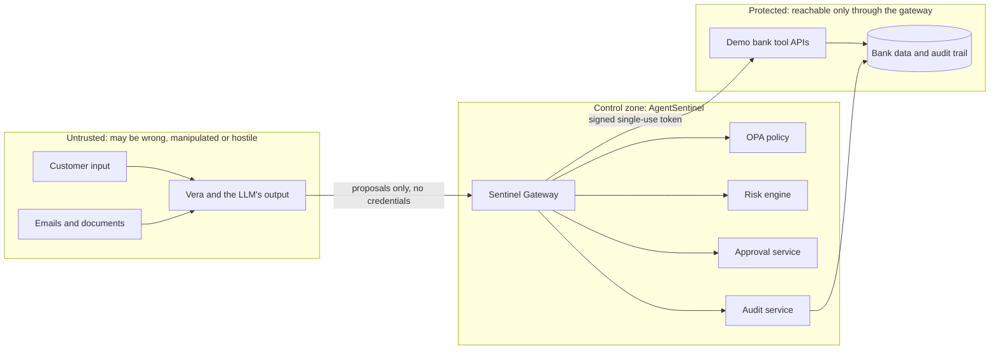
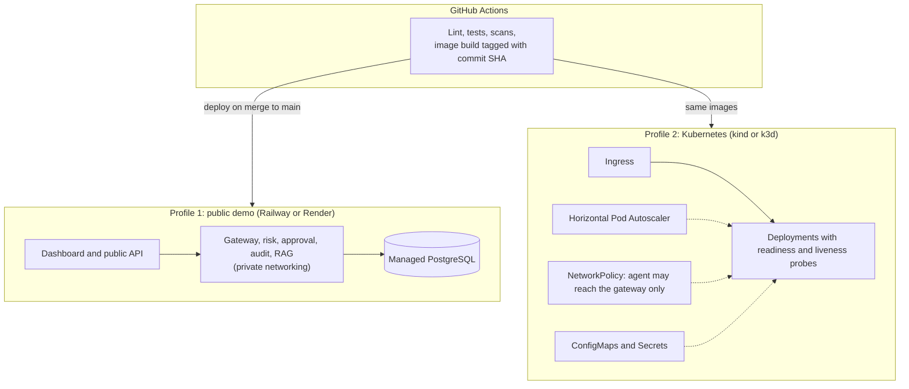

# AgentSentinel architecture

This is the design baseline for the capstone (story US-14, milestone M1). It restates Section 7 and Appendix E of the approved proposal, with diagrams that render on GitHub. Decisions and their reasons are in the [ADRs](../adr/README.md); threats and controls are in the [threat model](threat-model.md); requirement IDs are defined in the [requirements baseline](../requirements/requirements.md).

## 1. The idea in one paragraph

The AI agent proposes; AgentSentinel decides; a person decides when the risk needs human judgment. Vera, the banking agent, can never call a bank tool directly. Every protected action goes to the Sentinel Gateway, which checks who the agent is acting for, whether the tool is allowed, whether the details are sensible, what bank policy says, where sensitive values came from and how risky the behavior looks. Only an approved action reaches the bank, carrying a signed single-use token. Every decision is recorded in a tamper-evident audit trail and can be explained in plain English with policy citations.

## 2. System context

The single arrow from the gateway to the bank APIs is the point of the design: there is no other path to a protected tool (ADR-001).

## 3. Logical architecture

Service boundaries exist only where security, scaling, testing or ownership differ. The proposal's diagram also shows a Redis cache or queue; it is optional and will be added only if velocity counters or asynchronous explanation need it.

## 4. Components

| Component | Responsibility | Technology direction | Repository folder |
|---|---|---|---|
| Demo bank web app | Presents customer-service scenarios and invokes Vera | React or lightweight web client | `apps/dashboard` (shared UI) |
| AI banking agent (Vera) | Plans tasks and proposes tool calls; never receives bank credentials | Python agent, provider-neutral LLM adapter | `apps/banking-agent` |
| Sentinel Gateway | Intercepts actions, assembles context, runs the checks, enforces the decision, signs approved requests | FastAPI, Python | `services/sentinel-gateway` |
| Identity and scope module | Binds agent, user, session, customer and task; validates tool scope | Gateway module, session claims | `services/sentinel-gateway` |
| Policy service | Evaluates deterministic rules: refund limits, bulk export ban, rate limits, task and tool permissions | Open Policy Agent, Rego | `policies/opa` |
| Provenance module | Tracks where configured action parameters came from | Structured labels on arguments | `services/sentinel-gateway` |
| Risk engine | Scores an action and its recent sequence | scikit-learn; Logistic Regression baseline, Random Forest or gradient boosting comparator | `services/risk-engine`, `ml/` |
| Approval service | Creates, authorizes, expires, approves or rejects held actions | FastAPI, PostgreSQL | `services/approval-service` |
| RAG explanation service | Retrieves policy passages and writes a plain-English explanation after the decision | Embeddings, pgvector, external LLM adapter | `services/rag-service` |
| Audit and incident service | Stores hash-linked events, correlation IDs, policy and model versions, incident timelines | PostgreSQL | `services/audit-service` |
| Dashboard | Shows actions, approvals, incidents, agent state and health | React or server-rendered UI | `apps/dashboard` |
| Demo bank API | Synthetic customers, accounts, transactions, refunds and admin tools; accepts only gateway-signed requests | FastAPI | `apps/demo-bank-api` |
| Observability | Metrics, logs and traces | OpenTelemetry; Prometheus and Grafana in the Kubernetes profile | `k8s/` |

## 5. The seven-step decision pipeline

Cheap deterministic checks run first. Steps 1 to 5 are rules; step 6 is the machine learning risk signal, which can add caution but cannot overturn a hard block (ADR-003).

**Decision precedence:** hard deny, then quarantine condition, then mandatory human-review rule, then risk-based escalation, then allow. If required context is missing for a high-impact action, or a security dependency such as OPA is down, the gateway fails closed or asks for human review; it never guesses.

## 6. What happens to one action

## 7. Trust boundaries

The design assumes the agent may be mistaken, manipulated or compromised. Security-critical enforcement therefore sits outside the model and uses credentials the agent cannot reach.

## 8. Interface contracts

These are the minimum fields from proposal Appendix E. The Pydantic versions are built in story US-18; the stored entities are in [`data/synthetic/README.md`](../../data/synthetic/README.md).

| Contract | Minimum fields |
|---|---|
| ProtectedActionRequest | correlation_id, agent_id, user or session_id, customer_scope, task_type, tool_name, structured_arguments, provenance_labels, timestamp |
| PolicyDecision | policy_version, matched_rules, hard_decision, reasons |
| RiskAssessment | model_version, feature_schema_version, risk_score, risk_band, top contributing features where supported |
| GovernanceDecision | decision (ALLOW, HUMAN_REVIEW, BLOCK or QUARANTINE), reason_codes, approval_id if required, signed_execution_token if allowed |
| AuditEvent | correlation_id, event_type, actor, immutable timestamp, policy and model versions, decision or outcome, previous_event_hash, event_hash |
| ExplanationResponse | correlation_id, plain_english_reason, evidence_ids, policy sections, generated_at, model and provider version |

## 9. Architecture patterns

| Pattern | Where used | Reason |
|---|---|---|
| API Gateway and Policy Enforcement Point | Central interception boundary | Creates one enforceable path to protected tools |
| Policy as code | Bank business and security rules | Rules can be reviewed, versioned, unit-tested and deployed independently of prompts |
| Defense in depth | Rules, provenance, machine learning and human review | No single AI model is trusted as the only control |
| Maker-checker and human in the loop | High-value or unusual actions | Keeps human accountability for material decisions |
| Event-sourcing-style audit trail | Security decisions and incidents | Stores append-only events suitable for reconstruction |
| Circuit breaker and fail closed | Policy or risk dependency failure | High-impact actions stop when a security dependency fails |
| Repository pattern | Persistence access | Separates business logic from the PostgreSQL implementation |
| Adapter pattern | LLM, notification and model provider | Reduces vendor lock-in and makes testing easier |
| Dual deployment profile | Public demo and Kubernetes | A simple public deployment plus cloud-native orchestration evidence |

## 10. Deployment profiles

The public demo maximizes reliability for the grader. The Kubernetes profile demonstrates orchestration. The project does not claim that Railway or Render is Kubernetes (ADR-006).

| Kubernetes capability | Use in AgentSentinel |
|---|---|
| Deployments | Manage the stateless gateway, risk, RAG, approval, audit and dashboard workloads |
| Services | Stable internal discovery between components |
| ConfigMaps | Non-secret configuration such as thresholds and endpoint names |
| Secrets | API keys and credentials, kept out of source control |
| NetworkPolicy | Restrict unnecessary network paths; block the agent from reaching bank tools directly |
| Readiness and liveness probes | Remove unhealthy instances from traffic and restart failed workloads |
| Horizontal Pod Autoscaler | Scale a stateless service under load |
| Rolling updates | Deploy new versions gradually, with rollback |
| Resource requests and limits | Prevent uncontrolled CPU and memory use |
| Ingress | Expose only intended public entry points |

## 11. Design rules that every change must respect

1. Deny by default for unknown sensitive actions.
2. Least privilege: the agent never receives unrestricted bank credentials.
3. Rules decide; AI advises. A model cannot override a deterministic deny.
4. Human judgment is mandatory for configured material actions.
5. Fail closed for high-impact decisions when a required security dependency is unavailable.
6. Every decision is observable and reconstructable.
7. The protected path must be non-bypassable in the reference architecture.
8. Policies, prompts, models and tool schemas are versioned artifacts.

A change that touches any of these needs an ADR and a Code Owner review.
